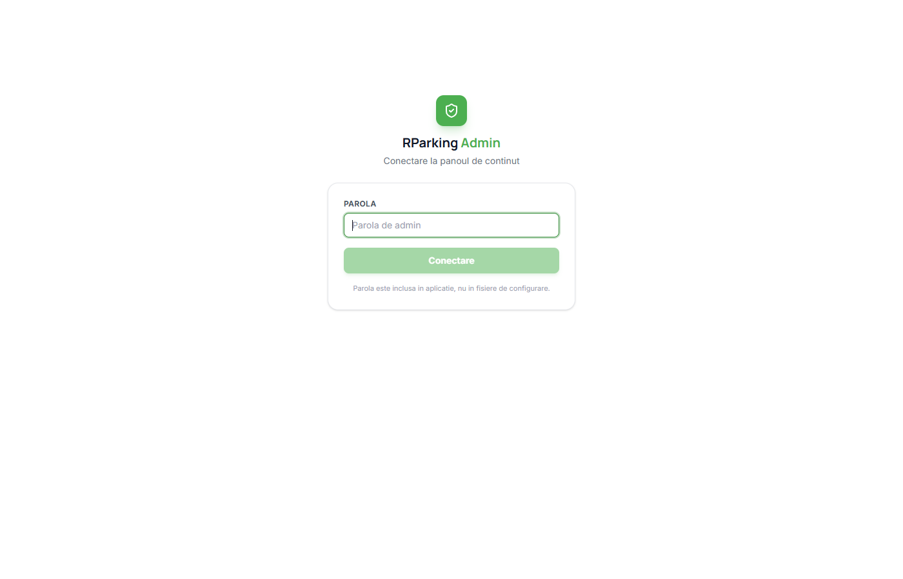
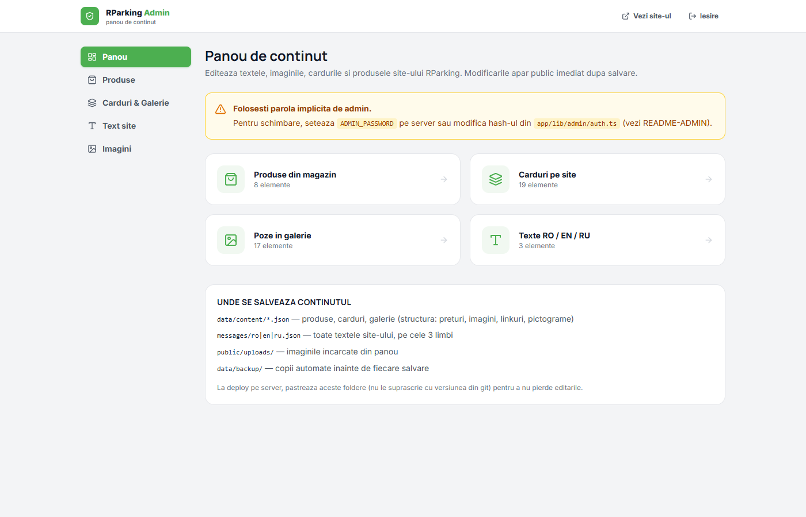
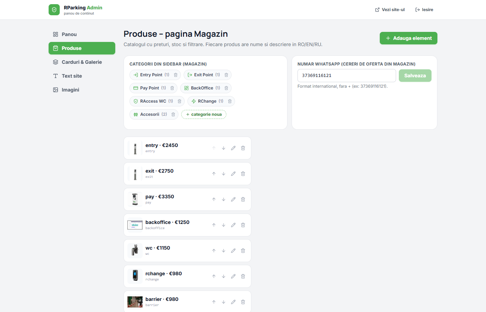
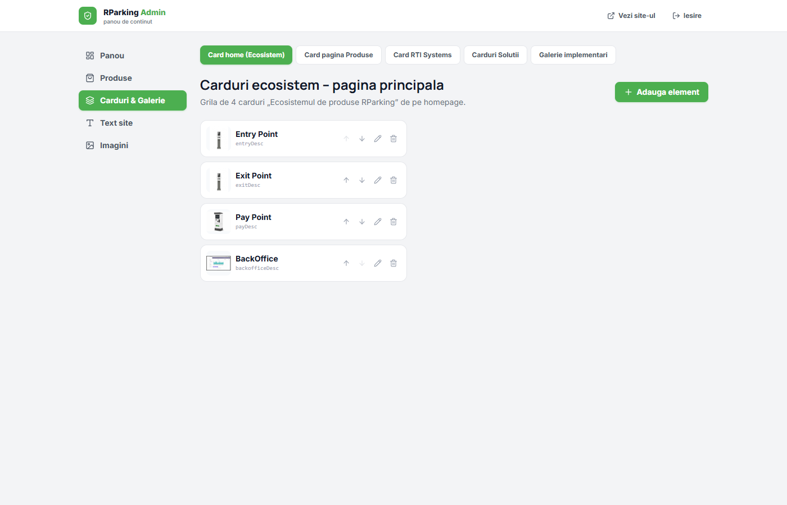
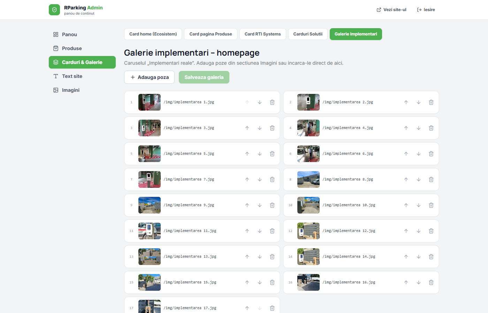
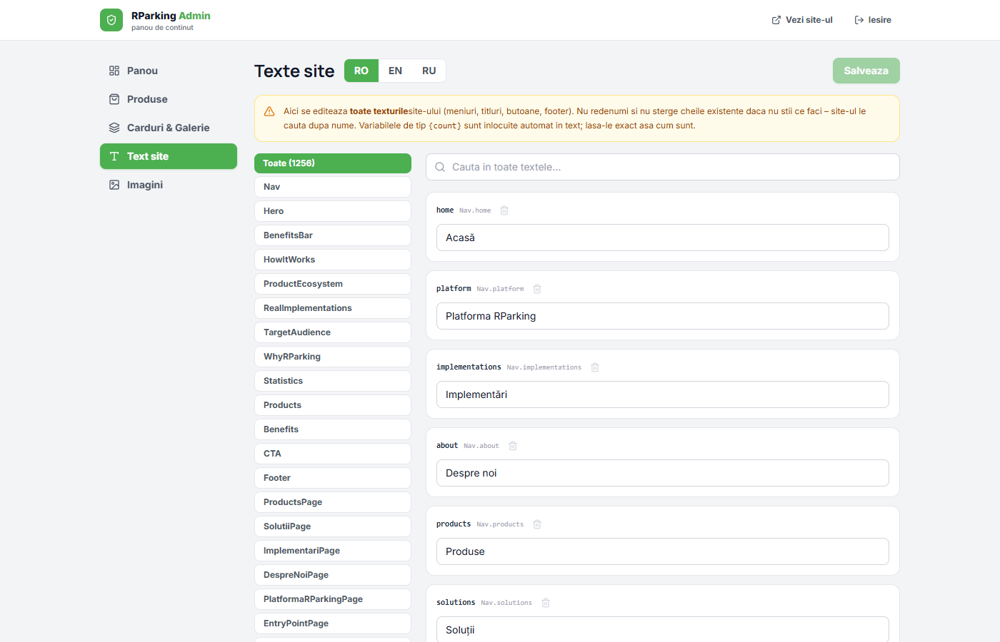
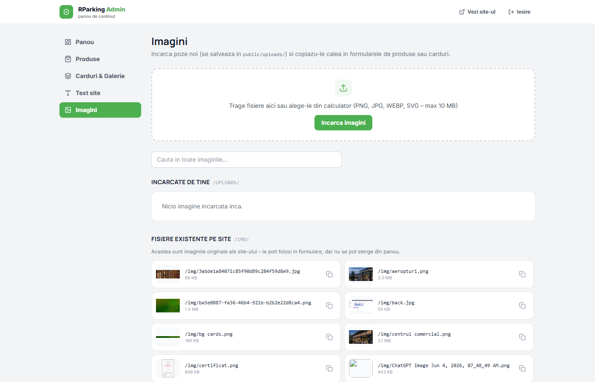
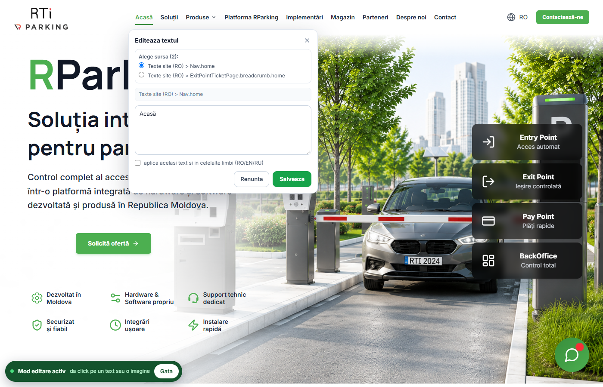
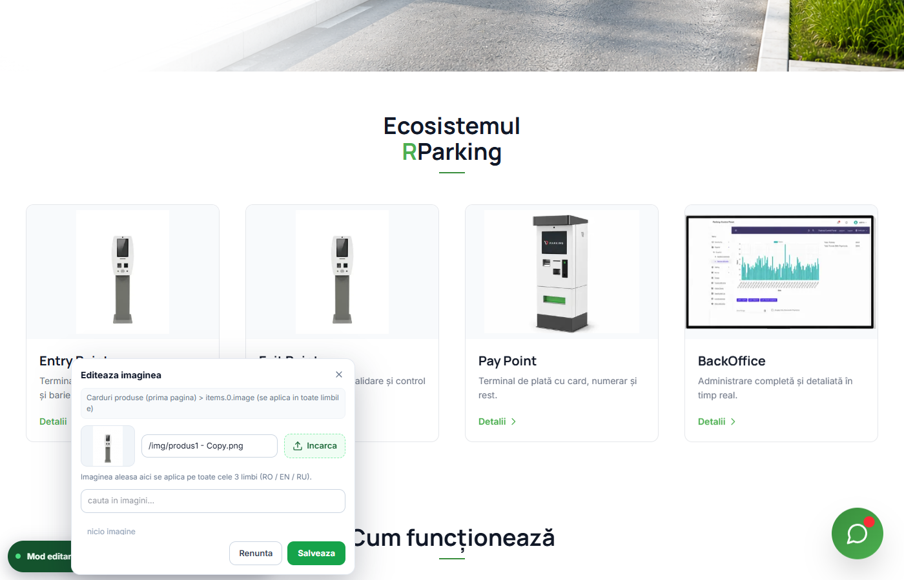

# Manual de utilizare - Panou Admin RParking

Acest manual explica, in limbaj simplu, cum folosesti panoul de administrare al site-ului RParking. Nu sunt necesare cunostinte tehnice: toate modificarile se fac din browser, fara cod. Fiecare capitol are imagini cu ecranele pe care le vezi in timp real.

Cuprins:

1. [Conectare](#1-conectare)
2. [Panou (pagina principala)](#2-panou-pagina-principala)
3. [Produse](#3-produse)
4. [Carduri si galerie](#4-carduri-si-galerie)
5. [Texte site](#5-texte-site)
6. [Imagini](#6-imagini)
7. [Editare directa pe site](#7-editare-directa-pe-site)
8. [Unde se salveaza datele](#8-unde-se-salveaza-datele)
9. [Server si deploy](#9-server-si-deploy)
10. [Intrebari frecvente](#10-intrebari-frecvente)

---

## 1. Conectare

Deschide in browser adresa **`/admin`** (de exemplu `https://adresa-site-ului/admin`, iar pe calculatorul local `http://localhost:3210/admin`).

Scrie parola si apasa **Conectare**.

- Parola implicita este `parc-admin-2026`. Este inclusa in aplicatie (nu in `.env.local`), ca hash, in fisierul `app/lib/admin/auth.ts`. Optional, pe server se poate seta `ADMIN_PASSWORD`.
- Sesiunea ramane activa **7 zile**. Nu trebuie sa introduci parola la fiecare vizita in panou.
- Pentru deconectare foloseste butonul **Iesire** din coltul din dreapta-sus al panoului.
- Parola gresita de 10 ori consecutive blocheaza accesul pentru 15 minute.

> Recomandare: inainte de prima utilizare reala, schimba parola implicita. Programatorul inlocuieste hash-ul din `app/lib/admin/auth.ts` (comanda de generare este in comentariul fisierului) si reporneste serverul.

---

## 2. Panou (pagina principala)

Dupa conectare apare pagina **Panou de continut**. De aici pornesti catre toate sectiunile admin.

Cele 4 dale sunt intrarile principale in administrare:

- **Produse din magazin** - produsele, preturile, filtrele si stocul
- **Carduri pe site** - grilele de carduri care apar pe pagini
- **Poze in galerie** - caruselul „Implementari reale" de pe homepage
- **Texte RO / EN / RU** - toate textele site-ului, pe cele 3 limbi

Meniul din stanga trimite la aceleasi pagini. Sus ai doua butoane: **Vezi site-ul** (deschide site-ul public ca sa verifici modificarile) si **Iesire** (deconectare).

Orice salvare apare public **imediat**, fara rebuild si fara programator. Panoul e vazut doar de cine are parola; vizitatorii site-ului nu il pot accesa.

Sub dale este caseta **UNDE SE SALVEAZA CONTINUTUL**. Detalii complete in capitolul [8. Unde se salveaza datele](#8-unde-se-salveaza-datele).

---

## 3. Produse

Meniul lateral, apoi **Produse**. Aici administrezi catalogul care apare in pagina Magazin.

### Categoriile din sidebarul magazinului

Sus, in stanga, este caseta **CATEGORII DIN SIDEBAR (MAGAZIN)**. Fiecare categorie arata si numarul de produse, de exemplu „Entry Point (1)".

Pentru categorie noua:

1. Apasa butonul verde **+ categorie noua**.
2. Scrie numele in RO (obligatoriu), apoi daca vrei si in EN si in RU.
3. Alege o pictograma.
4. Apasa **Adauga**. Categoria apare imediat in filtrul din pagina Magazin.

Pentru stergerea unei categorii apasa cosul de langa numele. Categoria se sterge doar daca este goala; daca are produse, primesti un mesaj cu numarul de produse care trebuie mutate intr-o alta categorie.

### Numarul WhatsApp

Caseta din dreapta, **NUMAR WHATSAPP (CERERI DE OFERTA DIN MAGAZIN)**, este numarul care primeste mesajele „Solicită ofertă" din magazin. Scrie-l in format international, fara „+", de exemplu `37369116121`, apoi apasa **Salveaza**.

### Lista produselor

Sub cele doua casete este lista completa de produse, cu nume, pret si imagine mica. Fiecare rand are 4 butoane mici:

- **sagetile Sus / Jos** - muta produsul cu o pozitie mai sus sau mai jos in lista
- **creionul (Editeaza)** - deschide fereastra de editare
- **cosul (Sterge)** - sterge produsul; cere confirmare si precizeaza ca textele asociate raman salvate

Butonul verde **+ Adauga element** creeaza un produs nou si deschide aceeasi fereastra de editare.

### Fereastra de editare a produsului

Campurile importante sunt:

- **Nume produs** si **Descriere produs**, pentru fiecare limba RO, EN si RU
- **Categorie** si **Tip** (Hardware / Software)
- **Utilizare (filtre)** - bifurile Parcare / Acces / Plata pentru filtrul din magazin
- **Pret (EUR, fara TVA)** - este un numar; se editeza doar aici
- **In stoc** - comutator: oprit inseamna „la comanda"
- **Imagine produs** - alege o imagine existenta, incarca un fisier sau lipeste un link https://...; se aplica pe toate cele 3 limbi
- **Incadreaza imaginea** - pornit: imaginea apare completa in card; oprit: imaginea acopera tot cardul
- **Link detalii** - de exemplu `/products/pay-point`. Lasat gol, butonul de pe produs cere oferta pe WhatsApp
- **Pictograma** - simbolul mic folosit in filtre si liste

Apasa **Salveaza** la final. **Renunta** inchide fereastra fara salvare.

> Pretul, ordinea, adaugarea si stergerea produselor se fac **doar in acest panou**, nu in editorul direct de pe site.

---

## 4. Carduri si galerie

Meniul lateral, apoi **Carduri & Galerie**. Sus ai 5 taburi, cate unul pentru grupa de carduri:

| Tab | Ce afiseaza pe site |
|---|---|
| **Card home (Ecosistem)** | grila de 4 carduri „Ecosistemul de produse RParking" de pe homepage |
| **Card pagina Produse** | grila „Solutii complete pentru fiecare etapa" din pagina `/products` |
| **Card RTI Systems** | sectiunea „RTI Systems" de pe homepage |
| **Carduri Solutii** | grila „Domenii de aplicare" din pagina `/solutii` |
| **Galerie implementari** | caruselul „Implementari reale" de pe homepage |

### Cum editezi un card

Lista arata ca la produse: sagetile muta cardul in ordine, creionul deschide fereastra de editare, cosul sterge, iar **+ Adauga element** creeaza un card nou.

Campurile importante in fereastra de card:

- **Titlu card** - acelasi text pe toate limbile (de obicei numele produsului)
- **Link** - adresa catre care duc butoanele „Detalii"
- **Imagine** - alege din lista, incarca un fisier sau lipeste un link https://...; se aplica pe toate cele 3 limbi
- **Arata imaginea** - comutator: oprit, cardul afiseaza ilustratia animata in loc de poza
- **Imagine pe toata cardul** - pornit: imaginea acopera cardul; oprit: imaginea apare incadrata
- **Descriere card** - textul de sub titlu, in RO, EN si RU

Campurile „Cheie" si „Cheie descriere" sunt identificatori tehnici: **lasati-le goale la elemente noi**, sistemul genereaza singur un cod unic. Nu le stergeti la cardurile existente, altfel pierzi textul asociat.

### Galeria de implementari

Tabul **Galerie implementari** administreaza caruselul „Implementari reale" de pe homepage.

- **+ Adauga poza**: adauga o imagine existenta din panou, incarca una de pe disc sau lipeste un link https://...
- numarul din stanga arata ordinea in carusel
- butoanele **Sus** si **Jos** muta poza cu o pozitie mai sus sau mai jos
- cosul scoate poza din carusel; imaginea ramane pe disc, doar dispare din galerie
- apasa **Salveaza galeria** dupa orice schimbare (butonul este activ doar cand exista modificari nesalvate)

---

## 5. Texte site

Meniul lateral, apoi **Text site**. Aici se editeaza toate textele site-ului: meniuri, titluri, butoane, formulare, footer.

### Limbile

Sus, langa titlu, ai butoanele **RO / EN / RU**. Intai editezi limba RO, apoi treci pe EN si RU ca sa scrii acelasi text in engleza si rusa. Pe site se foloseste mereu textul din limba selectata.

### Sectiuni si cautare

- In stanga este lista de sectiuni: `Nav`, `Hero`, `Footer`, `Products` etc. Fiecare sectiune corespunde unei zone a site-ului.
- Caseta **Toate** afiseaza toate textele, indiferent de sectiune; cifra din paranteze arata cate texte exista.
- Caseta **Cauta in toate textele...** cauta in toate textele, dupa numele cheii sau dupa continut. Scrii de exemplu „Acasă" ca sa gasesti textul din meniu.

### Reguli de aur la texte

1. **Nu redenumi si nu sterge cheile existente.** Site-ul le cauta dupa nume; o cheie stearsa face textul sa dispara de pe site.
2. Badge-urile cu variabile, de exemplu **`{count}`**, se inlocuiesc automat in text. Lasa-le exact asa cum sunt.
3. **Salveaza** e disponibil doar dupa o modificare. Mesajul galben „sectiuni nesalvate" arata cate sectiuni ai modificat.
4. Butonul **+ Cheie noua** adauga un text nou in sectiunea curenta.

---

## 6. Imagini

Meniul lateral, apoi **Imagini**. Aici incarci poze noi si copiezi calea lor pentru formularele de produse si carduri.

### Incarcare poze noi

- Trage fisierele peste zona punctata sau apasa **Incarca imagini** si alege din calculator.
- Formate acceptate: PNG, JPG, WEBP, SVG, maximum 10 MB per poza.
- Pozele incarcate apar in sectiunea **INCARCATE DE TINE**, in folderul `public/uploads/`, si sunt disponibile imediat dupa incarcare.
- Pentru o poza de pe alt site nu trebuie sa o descarci: in formularele de produs sau card poti lipi direct linkul.

### Caii imaginilor

- Fiecare rand arata o miniatura, calea completa (de exemplu `/img/centrul comercial.png`) si marimea pozei.
- Butonul cu doua patratele copiaza calea in clipboard. Lipeste-o apoi in campul de imagine dintr-un produs sau card.
- Sectiunea **FISIERE EXISTENTE PE SITE** (folderul `/img/`) aduna imaginile originale ale site-ului. Le poti folosi in formulare, dar nu se pot sterge din panou.
- Pozele din **INCARCATE DE TINE** se pot sterge cu cosul. **Atentie:** daca poza este deja folosita pe site, dispare si de pe site.

---

## 7. Editare directa pe site

Acest mod se foloseste pentru schimbari mici, facute direct pe pagina publica: dai click pe text sau pe imagine, scrii continutul nou, salvezi. Pentru structura site-ului (preturi, produse noi, carduri adaugate sau sterse) foloseste panoul descris in capitolele 3 si 4.

### Pas 1. Logare

Intra mai intai pe `/admin` si logheaza-te (vezi capitolul 1). Modul de editare apare doar pentru cine are sesiunea de admin; vizitatorii obisnuiti nu il vad niciodata.

### Pas 2. Deschide site-ul si porneste modul de editare

Deschide orice pagina publica a site-ului: butonul **Vezi site-ul** din panou sau direct adresa site-ului. In coltul din stanga jos apare butonul verde **Mod editare**:

Dupa apasare apare bara **Mod editare activ**, impreuna cu butonul **Gata**:

### Pas 3. Editeaza un text

Dai click pe un text de pe site: un meniu, un titlu, un paragraf sau un buton. Se deschide fereastra **Editeaza textul**:

- **Alege sursa**: acelasi text poate aparea in mai multe locuri. Fereastra arata toate locurile care il contin (aici 2). Alege prima sursa; celelalte conteaza doar daca acelasi text se repeta intentionat pe alte pagini.
- In zona mare de text scrii textul nou.
- Bifa **aplica acelasi text si in celelalte limbi (RO/EN/RU)**: scrie acelasi text si in engleza si in rusa. Fara bifa, se schimba doar limba curenta.
- **Renunta** inchide fereastra fara salvare. **Salveaza** salveaza si inchide fereastra.

Dupa **Salveaza** apare mesajul **„Salvat. Actualizez pagina..."**, pagina se reincarca singura si modul de editare ramane activ: navighezi pe alte pagini si continui sa editezi. Mesajul arata asa:

### Pas 4. Editeaza o imagine

In modul de editare, dai click pe o imagine de pe site, de exemplu poza unui card din grila „Ecosistem". Se deschide fereastra **Editeaza imaginea**:

- in partea de sus: previzualizarea imaginii actuale si calea ei (sau linkul), de exemplu `/img/produs1 - Copy.png`
- butonul **Incarca**: alege o poza noua de pe disc si calea se inlocuieste automat
- poti lipi direct in camp un **link https://...** pentru o imagine gazduita pe alt site
- caseta de cautare de jos listeaza imaginile existente pe site; alegi una din lista
- imaginea aleasa se aplica automat pe toate cele 3 limbi (RO / EN / RU)
- **Salveaza** aplica schimbarea; **Renunta** inchide fara salvare

### Iesirea din mod

Apasa butonul **Gata** din bara, in josul paginii, cand ai terminat editarea. Tasta **Esc** inchide fereastra deschisa, fara salvare.

### Editarea directa vs panou

| Ce vrei sa schimbi | Unde se editeaza |
|---|---|
| texte vizibile (meniuri, titluri, paragrafe, butoane) | direct pe site, in Mod editare |
| imaginea unui card sau produs | direct pe site (click pe imagine) sau in panou |
| pret, stoc, ordine, adaugare si stergere produse | doar in panou, la pagina [Produse](#3-produse) |
| adaugare sau stergere de carduri, ordinea lor | doar in panou, la pagina [Carduri si galerie](#4-carduri-si-galerie) |
| numarul WhatsApp | doar in panou, la pagina Produse |
| acelasi text in cele 3 limbi | in panou ([Text site](#5-texte-site)) sau cu bifa din editorul de pe site |

---

## 8. Unde se salveaza datele

Panoul si editorul de pe site scriu in aceleasi fisiere. Nu ai de lucrat direct cu ele, dar e bine sa stii unde se afla, mai ales la copiile de siguranta:

| Folder | Ce contine |
|---|---|
| `storage/content/*.json` | produsele, categoriile, preturile, stocul, cardurile, galeria (datele live) |
| `storage/messages/*.json` | toate textele site-ului, cate un fisier pe limba (datele live) |
| `public/uploads/` | imaginile incarcate de tine din panou sau de pe site |
| `storage/backup/` | cate o copie a fisierului salvat, creata automat inainte de fiecare salvare |
| `data/content/*.json`, `messages/*.json` | valorile implicite din repository (seed); se folosesc doar la prima pornire |

Trei lucruri importante:

- **Copiile de siguranta sunt automate.** Inainte de fiecare salvare, sistemul copiaza fisierul curent in `storage/backup/`, cu data si ora in nume. Se pastreaza ultimele 40 de copii. Daca ai modificat ceva din greseala, programatorul poate recupera de aici varianta de dinainte de greseala.
- **Salvarea e verificata inainte de scriere.** Daca un continut ajunge corupt sau invalid (de exemplu un link de imagine invalid), sistemul refuza salvarea si pastreaza datele vechi; site-ul public nu se strica.
- **Modificarile nu se pierd la actualizarea site-ului.** Datele live stau in `storage/`, un folder care nu face parte din repository. Un `git pull` obisnuit il lasa neatins.

---

## 9. Server si deploy

Cand site-ul este publicat pe server, tine cont de patru lucruri:

- **Pastreaza folderele de continut la publicare.** La fiecare actualizare a site-ului, pastreaza pe server folderele `storage/` si `public/uploads/`. `data/content/` si `messages/` sunt doar valori implicite (seed) si pot fi actualizate din repository fara sa pierzi modificarile.
- **Nu este nevoie de `.env.local`.** Parola este inclusa in aplicatie. Optional, pe server se pot seta `ADMIN_PASSWORD` (suprascrie parola) si `ADMIN_SECRET`.
- **Dupa schimbarea parolei in cod, reporneste serverul.** Parola noua nu are efect pana la repornire.
- **Nu rula `git clean -fdx` pe server.** Ar sterge `storage/`, `public/uploads/` si `node_modules`.

Modificarile facute din panou apar public imediat dupa salvare. Nu este nevoie de build sau de o publicare noua pentru o simpla modificare de text sau de pret.

---

## 10. Intrebari frecvente

**Butonul „Mod editare" nu apare pe site.**
Nu esti logat in panou: intra mai intai pe `/admin` si introdu parola. Butonul apare doar cand sesiunea de admin este activa. Daca esti logat si butonul tot nu apare, asteapta cateva secunde si reincarca pagina: dupa pornirea serverului, prima incarcare poate fi mai lenta.

**Am gresit parola de mai multe ori si nu mai intra.**
Dupa 10 incercari gresite, accesul se blocheaza 15 minute. Asteapta, apoi incearca din nou. Daca ai uitat parola, programatorul o schimba in cod, in `app/lib/admin/auth.ts` (hash-ul parolei), si reporneste serverul.

**Am salvat, dar pagina afiseaza textul vechi.**
Browserul tine paginile in cache. Apasa Ctrl+F5 (sau Shift+F5) pe pagina respectiva. Cand editezi direct pe site, pagina se reincarca singura, deci problema apare mai ales in alt tab deschis mai devreme.

**Vreau sa pun o imagine de pe alt site.**
In orice camp de imagine (produs, card, galerie sau editorul de pe site) poti lipi un link complet care incepe cu `https://` sau `http://`. Imaginea se afiseaza prin optimizatorul site-ului si se aplica pe toate cele 3 limbi. Daca site-ul sursa blocheaza afisarea pozelor pe alte site-uri, descarca imaginea si incarca fisierul in panou.

**Vreau sa schimb un pret sau numarul WhatsApp direct pe site, dar nu pot.**
Sistemul este gandit asa: preturile si numarul WhatsApp se editeaza doar in panou, la pagina [Produse](#3-produse), pentru ca acolo se valideaza formatul. Editorul de pe site e pentru texte si imagini.

**Am stricat un text sau am sters un card din greseala.**
Fii calm, datele au copie. In `storage/backup/` se pastreaza ultimele 40 de versiuni, cu data si ora in numele fisierului. Spune-i programatorului ce ai modificat si cand; el recupereaza varianta de dinainte de greseala.

**Cum adaug sau schimb un text in engleza si rusa?**
In editorul de pe site, bifeaza **aplica acelasi text si in celelalte limbi (RO/EN/RU)** daca vrei acelasi text peste tot. Daca vrei un text diferit pe fiecare limba, foloseste panoul, pagina [Texte site](#5-texte-site), si comuta intre butoanele RO, EN si RU.

**Cine vede panoul si butonul de editare?**
Doar cine are parola de admin. Panoul este exclus din indexarea in motoarele de cautare, iar butonul si barele de editare nu apar deloc vizitatorilor obisnuiti.

**Am facut modificari si dupa o actualizare a site-ului au disparut.**
Modificarile se salveaza in folderul `storage/` de pe server. Verifica impreuna cu programatorul ca acest folder (si `public/uploads/`) exista si nu a fost sters la publicare. Daca a fost sters, se poate recupera din copiile din `storage/backup/`.

**Cum verific daca modificarile arata bine pe site?**
Apasa butonul **Vezi site-ul** din panou si deschide pagina modificata. Pentru siguranta, verifica si dintr-un browser in care nu esti logat (sau o fereastra incognito), ca sa vezi exact ce vad vizitatorii.

---

*Manual RParking. Ultima actualizare: noiembrie 2026.*
